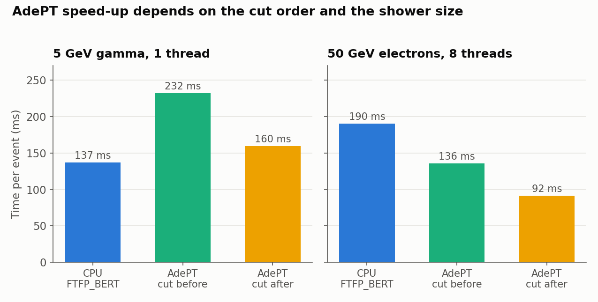
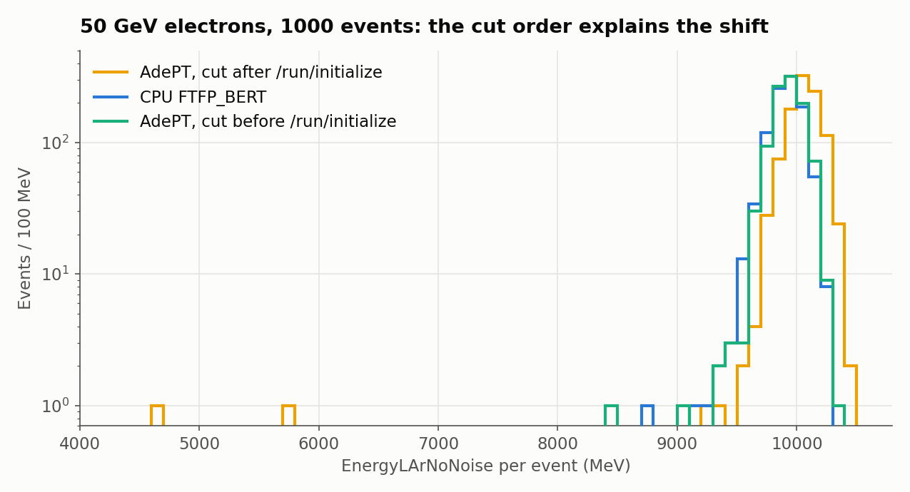
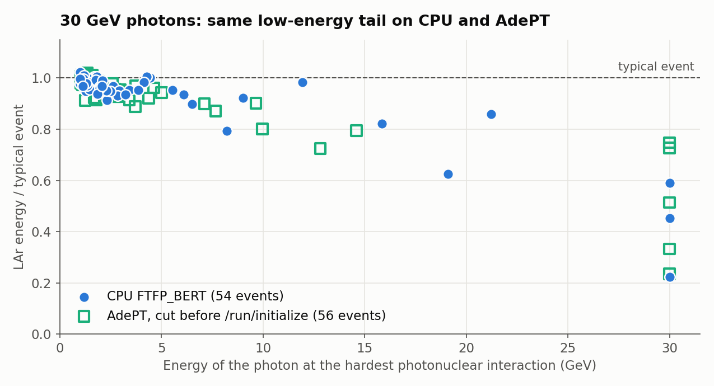
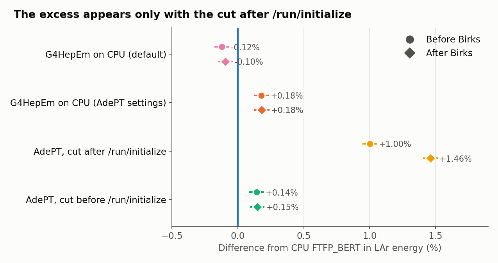
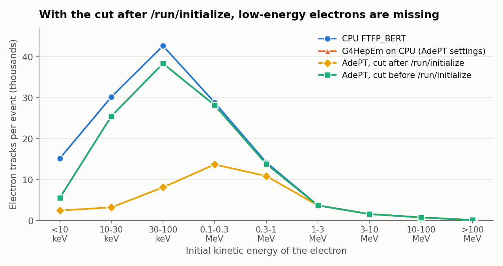
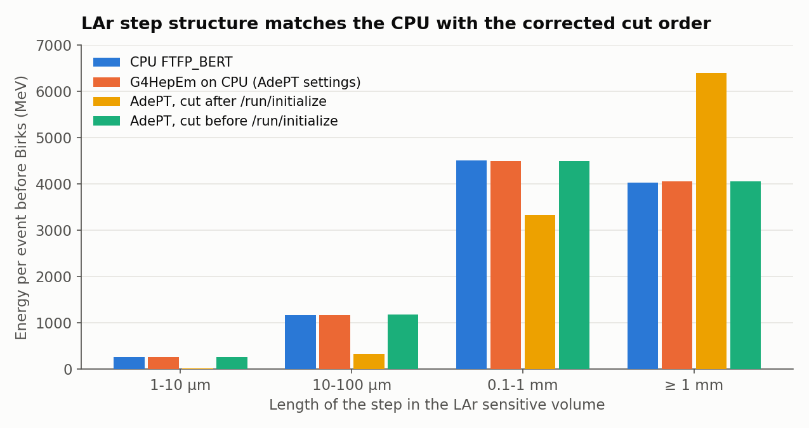

<!--
SPDX-FileCopyrightText: 2022-2026 Lorenzo Pezzotti and ATLLArBarrel contributors
SPDX-License-Identifier: MIT
-->

# Results

Performance and validation comparisons of ATLLArBarrel with different EM transport
options (Geant4 CPU, G4HepEm, AdePT on GPU), plus geometry and material checks.
Measurements taken in October–November 2026. Build options are described in
[BUILD_OPTIONS.md](BUILD_OPTIONS.md).

## Environment

| Component | Version / setting |
|---|---|
| Host | EL9, 24 cores, glibc 2.34, gcc 13.3 (gcc-toolset-13) |
| GPU | NVIDIA GeForce RTX 2070 SUPER (compute capability 7.5, 8 GB), driver 590.48, also driving the desktop display |
| CUDA | 13.1 |
| Geant4 | 11.4.3, Release, multithreaded, builtin expat |
| G4HepEm | commit `780e798` (tracking-manager mode only), built with `G4HepEm_CUDA_BUILD=ON` and `G4HepEm_EARLY_TRACKING_EXIT=ON` |
| VecCore / VecGeom | 0.8.2 / 2.2.0 (CUDA, GDML, scalar backend, `VECGEOM_NAV=index` unless stated) |
| AdePT | 0.4.2 |
| GeoModel | 6.33.0 (section 4 only) |

All runs use Release builds with `-DWITH_GPS=OFF` and the macros in `runcards/benchmarks/`:
`/run/setCut 0.01 mm`, gun at the origin, direction eta = 0.2, phi = 0.01225.
Times are the event-loop times printed by Geant4 at the end of the run (initialisation excluded).
`EnergyLAr` is the total energy per event in the LAr sensitive detector (Birks-corrected,
including electronic noise), in MeV. Errors on means are standard errors of the mean.
The ntuple now also has `EnergyLArNoNoise` (Birks-corrected, no noise), `EnergyLArNoBirks`
(no Birks correction, no noise) and `EventID`. They were added after the measurements below and are
used only in the runs with fluctuations on of sections 3a and 3b, and in the noise-free tables there.

## How to reproduce

Build the three configurations in separate directories, as described in [BUILD_OPTIONS.md](BUILD_OPTIONS.md):
`build-cpu` (default), `build-hepem` (`-DWITH_G4HepEm=ON`) and `build-adept` (`-DWITH_ADEPT=ON`).
Run from the build directory, after sourcing `geant4.sh`:

| Section | Command |
|---|---|
| 1a | `./ATLLArBarrel -m ../runcards/benchmarks/gamma5GeV.mac -t 1` (in `build-cpu` and `build-hepem`) |
| 1b | `./ATLLArBarrel -m ../runcards/benchmarks/electron50GeV.mac -t 1` (in `build-cpu` and `build-hepem`) |
| 3a | `build-cpu`: `gamma5GeV.mac -t 1`; `build-adept`: `gamma5GeV_adept.mac -t 1` |
| 3b | `build-cpu`: `electron50GeV.mac -t 8`; `build-adept`: `electron50GeV_adept.mac -t 8` |
| 4 | `build-cpu`: `./ATLLArBarrel -m ../runcards/benchmarks/geometry_test.mac -t 1` |

Section 2 uses AdePT's own `example1` (`example1.mac`) built with `VECGEOM_NAV=tuple` and `index`.
The energy statistics are computed from the `EnergyLAr` branch of `ATLLArBarrelout_Run0.root`.
With the default (fixed) seeds, repeated runs give bit-identical energy distributions, both on CPU
and with AdePT.

## 1. G4HepEm vs Geant4 FTFP_BERT (CPU)

- **FTFP_BERT**: Geant4 reference physics list (EM + hadronic).
- **G4HepEm**: `-DWITH_G4HepEm=ON`, i.e. `PhysListHepEmTracking` from `hepemlib/`: only the
  `G4HepEmTrackingManager` for e-, e+ and gamma (no hadronic physics), `MscRangeFactor = 0.04`.

### 1a. 5 GeV gamma, 300 events, 1 thread, 3 sequential repetitions

| Physics | Time per event | EnergyLAr mean (MeV) |
|---|---|---|
| FTFP_BERT | 136.7 ± 0.2 ms | 977.2 ± 10.1 (rms 175) |
| G4HepEm | 95.0 ± 2.0 ms | 964.3 ± 10.6 (rms 184) |

Speed-up **1.44** (−30.5 % time per event). The deposited energies are compatible (0.9 sigma).

### 1b. 50 GeV electrons, 150 events, 1 thread, 3 repetitions run concurrently

| Physics | Time per event | EnergyLAr mean (MeV) |
|---|---|---|
| FTFP_BERT | 1407 ± 2 ms | 9912.7 ± 15.7 (rms 192) |
| G4HepEm | 975 ± 1 ms | 9938.4 ± 17.7 (rms 216) |

Speed-up **1.44** (−30.7 %). The deposited energies are compatible (1.1 sigma).
The speed-up is the same as at 5 GeV, because the time is dominated by EM shower tracking.

## 2. VecGeom navigation state: `tuple` vs `index`

AdePT `example1` with its default macro: CMS 2018 geometry, 1 event with 200 electrons of 10 GeV,
transported on the GPU. VecGeom recommends `VECGEOM_NAV=index` for this geometry (navigation table
about 264 MB, below its 512 MB threshold).

| `VECGEOM_NAV` | Run time | Total deposited energy |
|---|---|---|
| `tuple` (default) | 2.60 s (1 run) | 899.66 GeV |
| `index` | 2.42 s, 2.39 s (2 runs) | 899.41 GeV (identical in both runs) |

`index` is about **8 % faster**. The small energy difference comes from a different random sequence.

## 3. AdePT (GPU) vs Geant4 FTFP_BERT (CPU)

- **AdePT**: `-DWITH_ADEPT=ON`: FTFP_BERT with the EM constructor replaced by
  `G4EmStandardPhysics_AdePT`, equivalent to AdePT's `FTFP_BERT_AdePT`. e-, e+ and gamma are
  transported on the GPU in all regions (1 M track slots, 1 M hit slots). GPU steps are returned
  to the CPU and processed by the unchanged ATLLArBarrel sensitive detector.
- **CPU**: the default build, FTFP_BERT.

**Energy-loss fluctuations.** AdePT switches them off by default, while FTFP_BERT on the CPU has them
on. The `*_adept.mac` macros now set `/adept/SetEnergyLossFluctuation true`, which is confirmed by the
G4HepEm configuration printed at initialisation. Below, "AdePT (fl. off)" are the earlier measurements,
which do not compare the same physics as the CPU, and "AdePT (fl. on)" are the matched ones. The runs
with fluctuations on, the noise-free values and the CPU re-runs of 2026-11-10 use the current code. A
re-run with fluctuations off on the current code reproduces the earlier EnergyLAr means exactly.

**Order of `/run/setCut` (important).** The `*_adept.mac` macros originally called `/run/setCut 0.01 mm` after
`/run/initialize`. With AdePT this order does not give the requested production cut on the GPU
(section 3c), so the rows labelled "fl. off" and "fl. on" below are not valid physics comparisons. Rows
labelled "cut before init" have `/run/setCut` before `/run/initialize`, as the macros do now, and they
are the reference AdePT results. The CPU runs are not affected.

### 3a. 5 GeV gamma, 300 events, 1 thread

| Setup | Time per event | CPU time / wall time | EnergyLAr mean (MeV) |
|---|---|---|---|
| CPU FTFP_BERT | 136.7 ± 0.2 ms (section 1a) | ~100 % | 977.2 ± 10.1 (rms 175) |
| AdePT (fl. off) | 142 ± 3 ms (3 runs) | ~26 % | 979.7 ± 9.9 (rms 171) |
| AdePT (fl. on) | 159.7 ± 0.4 ms (3 runs) | ~25 % | 969.5 ± 10.4 (rms 180) |
| **AdePT (fl. on, cut before init)** | 232.0 ± 1.9 ms (3 runs) | ~24 % | 960.5 ± 10.3 (rms 179) |

There is no gain: with the production cut applied, AdePT is **1.7x slower** than the CPU here. With a single CPU thread and one 5 GeV shower at a time the GPU is underused,
and the CPU thread waits for it about 75 % of the time. A later CPU re-run gave 141.8 ms per event,
so run-to-run variation on this machine is about 4 %. The mean energies agree within the
statistical precision of this sample (±1.4 %). The electronic noise dominates this error. Without it:

| EnergyLArNoNoise (MeV) | Mean | rms | Min |
|---|---|---|---|
| CPU FTFP_BERT | 970.7 ± 2.9 | 50.6 | 701.2 |
| AdePT (fl. off) | 981.8 ± 2.8 | 48.3 | 854.5 |
| AdePT (fl. on) | 986.7 ± 3.0 | 52.1 | 618.1 |
| **AdePT (fl. on, cut before init)** | 973.4 ± 2.6 | 45.2 | 834.5 |

With the cut before init, AdePT agrees with the CPU at 5 GeV: **+2.7 ± 3.9 MeV (+0.3 %, 0.7 sigma)**.
With the cut after init the difference was +16.0 ± 4.2 MeV (+1.6 %, 3.8 sigma) with fluctuations on and
+11.1 ± 4.0 MeV (+1.1 %, 2.8 sigma) with fluctuations off.

### 3b. 50 GeV electrons, 150 events, 8 threads, 2 repetitions

| Setup | Wall time | Throughput (time per event) |
|---|---|---|
| CPU FTFP_BERT | 28.99 s, 28.46 s | 191.5 ± 2.5 ms |
| AdePT (fl. off) | 12.87 s, 12.19 s | 83.5 ± 3.2 ms |
| CPU FTFP_BERT, re-run on the current code | 28.53 s, 28.54 s | 190.2 ms |
| AdePT (fl. on), 3 repetitions | 13.90 s, 13.64 s, 13.69 s | 91.6 ± 0.9 ms |
| **AdePT (fl. on, cut before init), 3 repetitions** | 20.31 s, 20.45 s, 20.37 s | 135.9 ± 0.5 ms |

With the matched physics and the production cut applied, AdePT is **1.4x faster** in throughput. The
2.1x (fluctuations on) and 2.3x (fluctuations off) speed-ups were measured with the cut after init, so they
do not compare the same physics. An earlier run with 160 events and fluctuations off gave 183 ms (CPU)
and 81 ms (AdePT).

| EnergyLAr (MeV) | Mean | Median | rms | Min |
|---|---|---|---|---|
| CPU FTFP_BERT | 9912.7 ± 15.7 | 9925.2 | 192 | 9308.5 |
| AdePT (fl. off) | 9990.4 ± 35.6 | 10028.7 | 436 | 5386.7 |
| AdePT (fl. off), without the event below 8 GeV | 10021.3 ± 17.9 | – | 219 | – |
| AdePT (fl. on) | 10017.0 ± 40.1 | 10063.8 | 491 | 4555.0 |
| AdePT (fl. on), without the event below 8 GeV | 10053.6 ± 16.3 | – | 198 | – |
| **AdePT (fl. on, cut before init)** | 9899.0 ± 19.0 | – | 232 | 8374.2 |

| EnergyLArNoNoise (MeV) | Mean | Median | rms | Min |
|---|---|---|---|---|
| CPU FTFP_BERT | 9913.8 ± 9.9 | 9932.1 | 121 | 9437.7 |
| AdePT (fl. off) | 10016.3 ± 31.5 | 10052.0 | 385 | 5672.4 |
| AdePT (fl. off), without the event below 8 GeV | 10045.4 ± 11.9 | – | 146 | – |
| AdePT (fl. on) | 10021.1 ± 38.1 | 10064.2 | 467 | 4622.2 |
| AdePT (fl. on), without the event below 8 GeV | 10057.4 ± 11.8 | – | 145 | – |
| **AdePT (fl. on, cut before init)** | 9920.7 ± 13.2 | – | 161 | 8472.5 |

With the cut before init the 50 GeV mean agrees with the CPU within the statistics of this sample
(+6.9 ± 16.5 MeV without noise).

**Events at about half the typical energy are physics.** With the cut after init, event 1 deposits
4622 MeV without noise (fluctuations on) and event 145 deposits 5672 MeV (fluctuations off). A diagnostic
build that returned all GPU steps and summed the energy per event showed:

- Every event below 8 GeV (events 1 and 372 with fluctuations on, event 145 with fluctuations off) contains
  a photonuclear interaction of a 29-35 GeV photon. The hadrons deposit little in the LAr, and 9-18 GeV of
  non-electromagnetic particles leave the world.
- The energy budget closes: deposits plus escaping energy average 49879 MeV with AdePT (cut before init)
  and 49881 MeV on the CPU, with 1000 events each.
- With 1000 electrons and the cut before init, no event is below 8 GeV. The lowest one deposits 8473 MeV
  and contains a 29.5 GeV photonuclear interaction. The CPU has none below 8 GeV, and its lowest event
  (8734 MeV) contains a 19.2 GeV photonuclear interaction.
- With 4000 photons of 30 GeV each, the tail is the same: photonuclear interactions above 25 GeV occur 5
  times with AdePT (cut before init) and 3 times on the CPU, with energies of 0.24-0.75 and 0.22-0.59 of the
  typical value. Events below 70 % of the typical value number 3 and 4, all with a photonuclear interaction
  above 10 GeV. The statistics of these events is small.

### 3c. Origin of the AdePT excess: order of `/run/setCut`

With `/run/setCut` after `/run/initialize`, AdePT deposited about 1.4 % more energy in the LAr than the CPU.
Moving the command before `/run/initialize` removes this excess. The comparison below uses a diagnostic
build, 1000 electrons of 50 GeV, 8 threads and fluctuations on. The "G4HepEm on CPU" setups replace only the
EM constructor of FTFP_BERT, so they use the G4HepEm physics with the Geant4 navigation. "AdePT settings"
disables the multiple MSC steps per transportation step, as AdePT does on the GPU. The values exclude events
with a photonuclear interaction above 1 GeV or more than 500 MeV of escaping non-EM energy.

| Setup | EnergyLArNoNoise (MeV) | Before Birks (MeV) | After/before Birks | Steps per event | e± steps in LAr | e± path in LAr (mm) | e± path in absorber (mm) |
|---|---|---|---|---|---|---|---|
| CPU FTFP_BERT | 9917.1 ± 4.0 | 9978.6 ± 4.0 | 0.9938 | 817985 | 163205 | 52131 | 31621 |
| G4HepEm on CPU, default | 9907.6 ± 3.8 | 9966.5 ± 3.8 | 0.9941 | 637319 | 104966 | 52117 | 31432 |
| G4HepEm on CPU, AdePT settings | 9935.2 ± 4.0 | 9996.5 ± 4.0 | 0.9939 | 788647 | 161753 | 52216 | 31403 |
| AdePT, cut after init | 10062.0 ± 4.1 | 10078.6 ± 4.1 | 0.9984 | 597269 | 82462 | 51041 | 29336 |
| **AdePT, cut before init** | 9931.7 ± 3.9 | 9992.8 ± 3.9 | 0.9939 | 791958 | 162949 | 52192 | 31418 |

- With the cut before init, AdePT is **+0.15 % ± 0.06 %** above the CPU, the same as G4HepEm on CPU with the same
  settings (+0.18 % ± 0.06 %). What remains is therefore the difference between the G4HepEm and FTFP_BERT physics,
  not a GPU effect. With the cut after init the difference was +1.46 % ± 0.06 %. Steps per event, Birks ratio and path
  lengths now also match G4HepEm on CPU.
- With the cut after init, the GPU produces 44 thousand electron tracks per event instead of 117 thousand. Only
  electrons below about 1 MeV are missing, while positrons and higher-energy electrons are unchanged. This is the
  behaviour expected from a higher production threshold.
- A run with no `/run/setCut` at all gives a mean of 10035 MeV without noise for 150 electrons, close to the 10021 MeV
  of the cut after init but not bit-identical. This is consistent with the GPU tables keeping the default cut, but the
  exact mechanism inside AdePT has not been identified.
- The total deposit in the detector is the same in all cases (about 49790 MeV), so energy was shared differently
  between absorber and LAr rather than lost.
- Reducing the MSC safety factor from 0.6 to 0.1 did not change the gap, so the GPU safety estimate was not the cause.

The macros `runcards/benchmarks/*_adept.mac` now set the cut before `/run/initialize`, so they reproduce the
cut-before-init rows. With the cut before init AdePT agrees with the CPU to better than 0.2 %, but it has only been
compared on these benchmarks (5 GeV gamma, 30 GeV gamma and 50 GeV electrons).

### 3d. Sensitive detector and step transfer from GPU to CPU

AdePT copies the GPU steps back to the CPU and calls the unchanged Geant4 sensitive detector, under two
conditions in its documentation: user code must not cache per-track state in shared members, and it must
not kill tracks.

**The ATLLArBarrel sensitive detector meets these conditions.** It is created per worker in
`ConstructSDandField` and attached to `LAr::EMB::STAC`. `ProcessHits` keeps no per-track state and uses only
the pre-step position, the total energy deposit and the step length, which are all copied from the GPU.
AdePT drains the returned steps before the end of the event. Checks on the copied steps, with the cut before init:

| Check | Result |
|---|---|
| 300 events of 50 GeV electrons, about 95 million sensitive-detector calls | every step in the sensitive volume reaches it |
| Energy per event, sensitive detector against a sum over the same steps | identical in all events |
| Distance between pre- and post-step point larger than the step length | 0 steps |
| Electron energy deposit larger than its kinetic energy | 0 steps |
| 5 GeV gamma, default mode against all steps returned, events without a nuclear reaction | 89 of 89 agree within the print precision |

In events with a nuclear reaction the two modes differ by up to 17 MeV at 5 GeV and 26 MeV at 50 GeV, with a mean
of -0.06 and -0.13 MeV. These reactions use CPU random numbers, whose sequence depends on the order of the
returned steps, but this explanation has not been isolated. All 50 GeV events contain at least one reaction.

**AdePT limitation: nuclear secondaries have ParentID 0 by default.** Unless the host keeps the track data
(`/adept/returnFirstAndLastStep true`, `/adept/returnAllSteps true`), GPU tracks are reconstructed on the CPU with
the dummy track ID 0. Hadrons created by a photonuclear or electronuclear reaction on a GPU step then get
**ParentID 0, the same value as a real primary**, and Geant4 user code cannot tell them apart from primaries by
ParentID. Their tracking on the CPU is otherwise normal, so energies and hits are not affected. The dummy track ID
appears in a comment of the AdePT code, but the AdePT user documentation does not mention this effect.

`HadInteraction` selected primaries with `GetParentID()==0`, so it was wrongly set with AdePT. The tracking action
now identifies primaries by their attached `G4PrimaryParticle`, which does not depend on the track IDs:

| Sample | Setup | Events with `HadInteraction` = 1 |
|---|---|---|
| 50 GeV e-, 150 events | CPU FTFP_BERT | 0 |
| | AdePT, default, previous code | 135 |
| | AdePT, `/adept/returnFirstAndLastStep true`, previous code | 0 |
| | AdePT, default, fixed code | 0 |
| 5 GeV gamma, 300 events | AdePT, default, fixed code | 0 |
| 20 GeV pi-, 300 events | CPU FTFP_BERT, fixed code | 253 |
| | AdePT, default, fixed code | 253 |

The pion sample confirms that the flag still works for real primaries. Its mean energy without noise is
1412.5 ± 61.8 MeV with AdePT and 1371.5 ± 61.9 MeV on the CPU, compatible with each other (0.5 sigma) with a large
error. Returning the first and last steps took 20.5 s against 20.4 s for 150 electrons (one run).

## 4. Geometry overlap checks

Tolerance 10 um, 200 random points per volume.

| Geometry checked | Tool | Overlaps |
|---|---|---|
| `GDMLs/experimentalHall_v0p1.gdml` converted with GeoModel `gdml2gm` | `gmclash -t 0.01 -n 200` | 3749 |
| `GDMLs/experimentalHall_v0p1.gdml` (original) | `gmclash -t 0.01 -n 200` | 1 |
| Current geometry (17808 volumes) | `geometry_test.mac` (Geant4 `/geometry/test/run`) | 1 (same volume) |

- 3748 of the 3749 overlaps in the converted geometry are artefacts of the GDML -> GeoModel
  conversion, all in the EMB accordion. Straight sections are reported about 1.56 m outside their
  mother `STAC`, and folds overlap straight sections by a constant 2.2 mm (absorbers) and 0.27 mm
  (electrodes). The converted geometry should not be used.
- The single real overlap: the first cathode `catho3` of presampler module `mod[1]` (electrodes
  tilted by −12°) protrudes by about **1.0 mm** from `LAr::Barrel::Presampler::Module`.
  The tilted cathode spans ±1.47 mm in the stacking direction, but its centre is only 0.44 mm from
  the module edge (margin `mod[1][5] = 0.3 mm` + half thickness + `epsil`). It is not fixed yet:
  the parameters come from the original ATLAS code.

## 5. Material definitions

The material table (`/material/g4/printMaterial all`) was compared before and after the
introduction of `MaterialManager` (NIST elements, no duplicated materials):

- All densities are unchanged. Duplicate-material warnings went from 8 to 0.
- Radiation lengths changed by less than 0.15 % because of the NIST elements (largest: `Cables`,
  5.825 -> 5.817 cm).

Two pre-existing bugs were then fixed. They change the physics, and all the measurements above
were taken after these fixes:

| Material | Before | After |
|---|---|---|
| `Gten` (unit `g/cm` instead of `g/cm3`) | 180 g/cm3, X0 = 2.2 mm | 1.8 g/cm3, X0 = 22.3 cm |
| `SiO2` (uses the Gten density) | 180 g/cm3 | 1.8 g/cm3 |
| `MBoards` (mixture with Gten) | 155 g/cm3, X0 = 2.5 mm | 2.85 g/cm3, X0 = 7.1 cm |
| `Cables` (mass fractions 62 % + 39 % = 101 %) | 3.003 g/cm3 | Kapton 38 %: 3.035 g/cm3 |

## Caveats

- In the runs above `HadInteraction` is always 0 because of a bug in `ATLLArBarrelTrackingAction`,
  fixed after these measurements: the condition `type != "baryon" || type != "meson"` was always
  true. These runs cannot be used to show that hadronic
  interactions are negligible. For the e-/gamma beams used here they are expected to be small,
  but this is not demonstrated. Even after the fix the flag only records inelastic interactions of
  a primary baryon or meson. It stays 0 for e-/gamma beams and does not detect photonuclear or electronuclear
  interactions. Before the fix of section 3d it was wrongly set with AdePT in most events, so the
  `HadInteraction` values of AdePT runs taken before that fix must not be used.
- Repetitions use the same random seed, so the timing errors reflect machine noise only, not
  event-to-event variation.
- The G4HepEm comparisons involve an EM-only physics list and a different MSC range factor (0.04),
  so they are not a matched control for the AdePT comparison of section 3.
- The GPU is a consumer card with low FP64 throughput (AdePT computes in double precision), and it
  also drives the desktop display. GPU results are not representative of data-centre GPUs.
